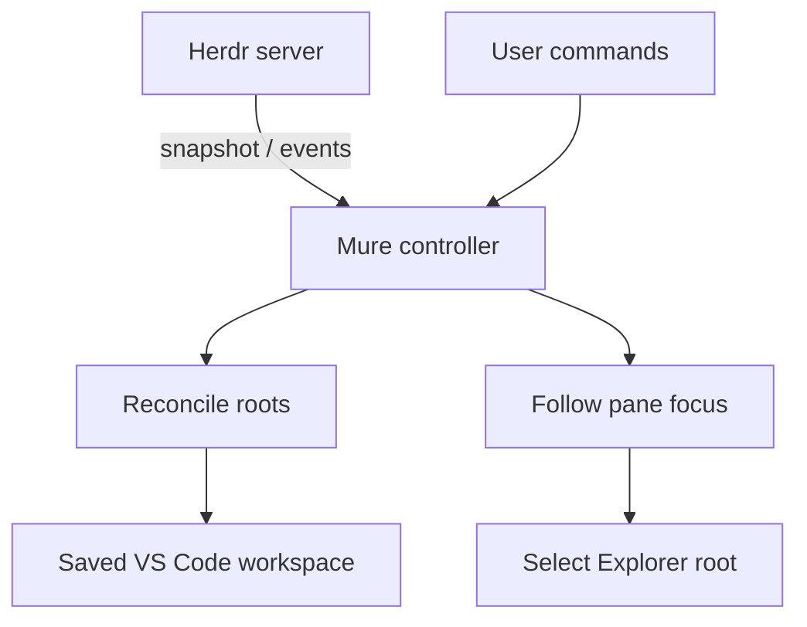

# Mure design

**PROPOSED — not implemented.** Interface names and behavior here are design proposals, not delivery authorization. The [workbench draft](docs/issues/persistent-workbench/KFDQFD-spec.md) is a held outcome reference. Use roadmap cards to develop bounded specs; settle architecture and the first release before implementation. See [PRODUCT.md](PRODUCT.md) for intent and [CONTEXT.md](CONTEXT.md) for domain language.

## Shape

One persistent, saved VS Code multi-root workspace sits beside Ghostty and Herdr. A thin extension reads the selected local Herdr server's snapshots and events directly. Herdr and VS Code must share filesystem identity; remote path translation is outside the initial scope. Observed runtime evidence is macOS, not a macOS-only product policy.

The native `.code-workspace` is the only folder manifest; there is no additional `workspaces.yaml`. Mure's persistent per-binding metadata records ownership and exclusions, not a second folder manifest. One explicitly configured saved VS Code workspace and Herdr endpoint form a binding. Setup explains that binding authorizes automatic addition of qualifying local checkouts reported by that server, subject to native Workspace Trust decisions; adding roots exposes them to project-sensitive tooling. Mure must not mutate arbitrary windows or use `code --reuse-window` to choose a target. At most one controller is active for a saved workspace, bound to one selected server; duplicate activation is passive even if a second instance requests another endpoint. The coordination mechanism remains an implementation decision.

## Roots and identity

| Case | Proposed behavior |
| --- | --- |
| Home | User selects a permanent first root. Changing it is a deliberate settings/setup operation with a restart warning. |
| Live checkout | A distinct Git checkout referenced by a live Herdr workspace or pane is eligible for automatic addition. |
| Pane directory | Resolve the live pane's current directory when more specific than stale workspace checkout metadata, or when worktree metadata is absent. Subdirectories of one checkout deduplicate. |
| Git worktree | Canonical checkout path is identity; different worktrees remain distinct. Never normalize by remote or main repository. Multiple panes referencing one checkout load it once. |
| Other directories | Non-Git directories are unsupported in v1 except the selected home and manually added roots. |
| Manual root | Preserve it; never infer Mure ownership merely because a folder is present. |
| Missing checkout | Report it as missing; do not recreate it or treat absence as permission to delete anything. |
| Display | Basename and branch may disambiguate labels, but never determine identity. |

Membership comes from live Herdr workspaces and **all** live pane checkouts, not saved-project or zoxide inventories. Keep all loaded checkout roots while following focus; selecting context must not reorder roots, open or close files, retarget terminals, or take OS keyboard focus. On a focused Herdr pane, select, reveal and expand the matching Explorer root; visibility alone does not satisfy following. A disposable native `revealInExplorer` probe demonstrated root selection while VS Code remained unfocused. Preservation of existing editors/terminals and integrated Herdr following still need verification. User-initiated setup may foreground or reload VS Code; background following may not.

## Reconciliation and safety

Validate reported directories as local absolute filesystem paths before probing/loading; reject malformed/relative paths and remote URI interpretation. Never substitute another endpoint or bypass native trust decisions. A snapshot gives the current desired candidates; events prompt fresh source lookups as needed. Coalesce focus changes, serialize workspace writes, and revalidate plans against current state before applying them. On reconnect, read current state rather than replaying a stale focus queue. Home stays first during ordinary following; folder updates must not mutate it.

| State | Membership / following |
| --- | --- |
| Connected, fresh, complete | Reconcile eligible candidates; follow current pane if enabled. A root is inactive only when no live reference remains. |
| Disconnected, error, or partial snapshot | References are unknown, not inactive. Do not automatically remove roots; show connection state. |
| Paused | Stop background membership writes and focus following; expose a way to resume. Connection and membership status remain visible. |
| Missing or unresolved root | Show a root-not-found warning; do not invent a checkout or delete data. |
| Duplicate controller | Stay passive and surface the conflict; never run competing writes. |

Default cleanup is **offer**: keep inactive roots until the user invokes a multi-select chooser. Optional **automatic** cleanup removes only Mure-owned folder membership when a connected, fresh, complete server state confirms no live references. Neither mode deletes data, repositories, or worktrees, or runs user commands. Protect home and manual roots; defer removal for known dirty documents, debug sessions, or terminals, and when association of a live terminal or active debug session is unknown. Arbitrary third-party extension session state is not fully observable and cannot be guaranteed safe.

The draft spec proposes persisting a canonical-path exclusion when the user manually removes a managed root, preventing immediate re-add until explicit restoration. Ownership and exclusions survive restart; a currently present folder alone is not proof of ownership. Manual re-add is user-owned; an explicit Mure restore may record Mure ownership again. Ambiguous ownership is protected, not automatically adopted.

## Proposed interfaces

Native command palette, status, and settings are sufficient; no custom sidebar or webview is required.

| Interface | Purpose |
| --- | --- |
| Select home / setup | Bind the saved workspace and endpoint, choose home, and explain first-root restart behavior. |
| Connection and follow status | Show connected, disconnected, paused, conflict, and root-not-found/warning states. |
| Refresh | Re-read current state and reconcile without replaying stale focus. |
| Pause / resume follow | User controls background following. |
| Clean up inactive Mure roots | Multi-select eligible owned roots; retain protected or deferred roots. |
| Restore excluded roots | Optional simple command to undo a persisted exclusion. |

Keep settings small: `homeDirectory`, cleanup mode (`offer` or `automatic`), and endpoint discovery with an explicit override when necessary. Selecting home does not install or configure Foam; Mure works without it. Existing Navigator follow must not run in the same workspace: surface the conflict for user-managed resolution rather than globally disabling the extension.

## Evidence and boundaries

- Herdr 0.9.5 protocol 22 snapshots expose focused workspace, tab, and pane IDs and workspace/tab/pane data. Workspace worktree metadata includes optional `checkout_path` and `repo_root`, which are not interchangeable; pane data includes `cwd` and `foreground_cwd`.
- Schema events include workspace created/updated/closed/focused, worktree created/opened/removed, tab focused, and pane focused. Directory resolution needs snapshots/source lookups; no dedicated cwd event is established. Existing Navigator polls.
- Herdr Plus saved projects use `.toml`; the terminal Navigator plugin reads `zoxide query -l` then focuses or creates a workspace. Mure observes resulting live state and does not hook either picker.
- VS Code documents that changing the first folder restarts the extension host. In a live experiment, home was moved first once and later file navigation kept the extension-host PID unchanged; four prior root-reorder switches each restarted hosts. A later disposable extension probe selected three roots via `revealInExplorer`: DOM selection was observed, root order/host PID stayed unchanged, and VS Code reported unfocused throughout. Partial OS samples showed Ghostty frontmost; the user confirmed the behavior. No editor or terminal was active, so their preservation remains untested.
- Navigator extension 0.3.1 anchors an empty first root, swaps remaining folders, and gates auto-follow to integrated Herdr hosting. Its terminal restore/cd behavior is not a wholesale design to reuse.
- Foam 0.48 uses first-root `.foam/queries` definitions and a combined note index; grouped relative paths can collide across worktrees. A PersonalObsidian pilot with nine YAML views and a Markdown dashboard was reported workable, without changing original vault notes. Foam is an optional consumer, not a requirement to migrate notes or generate queries.
- GitHub PR grouped roots worked in user observation; source research on 0.176.1 found possible first-remote-match worktree ambiguity, while the later installed runtime was 0.178.0. Dart/Flutter 3.146 documents multi-root support; differing SDK isolation is unverified. No blanket compatibility guarantee is made for extensions.

## Acceptance seams and distribution

- Exercise a pure reconciler with fake snapshots for canonical-path deduplication, all-pane membership, stale workspace metadata, exclusions, ownership, missing paths, incomplete state, and cleanup protection.
- Use real VS Code extension-host tests to verify ordinary updates never mutate the first root or reload the host. Verify Explorer selection and separately observe OS keyboard focus during background following; host-level assertions alone do not establish it.
- Test concurrent/duplicate activation, coalescing, write serialization and stale-plan revalidation, reconnect without focus replay, and persistence across restart.
- Proposed distribution is an MIT-licensed public VS Code extension via GitHub Releases VSIX, not Marketplace initially. No scaffold or build-tool choice has been accepted.
