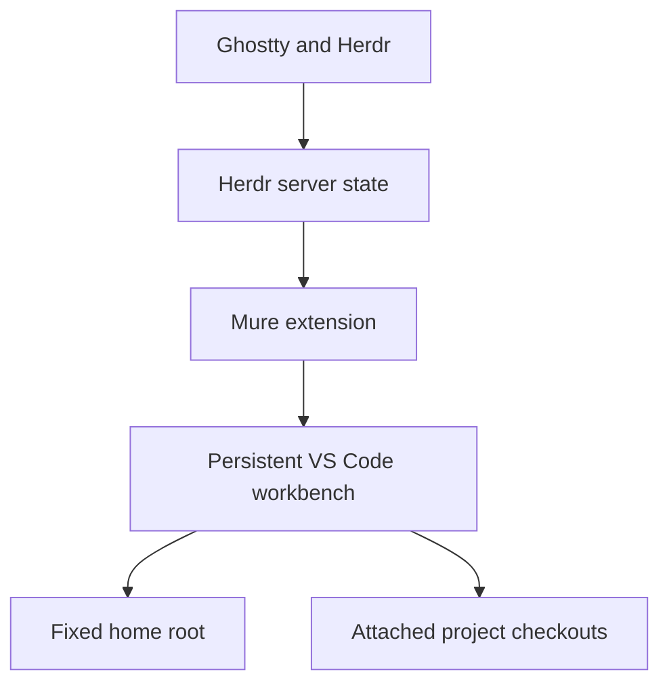

# Mure

**Status: product direction; no extension implementation yet.** Develop capabilities
through [roadmap cards](docs/roadmap/), then individually reviewed and accepted bounded
specs under [`docs/issues/`](docs/issues/). The current broad workbench draft is a held
outcome reference, not a whole-extension delivery assignment. Architecture and the first
release boundary remain to be settled.

## Purpose

Keep one persistent VS Code workbench coordinated with the work happening in Herdr,
without repeatedly reopening projects or restarting extensions.

The motivating setup is an ultrawide display with Ghostty/Herdr on one side and VS Code
on the other. Herdr holds agents and terminal processes. VS Code holds code, personal
notes, queries, pull requests, tests and debugging. Mure connects the two surfaces; it
is not another terminal manager, note system or issue tracker.

## Core model

| Concept | Product behavior |
| --- | --- |
| Home | User chooses a directory during setup and can change it later in settings. It remains the first workspace root and is never an automatic-cleanup candidate. |
| Workbench | One explicitly configured, saved multi-root VS Code workspace. Its native `.code-workspace` file is the folder manifest; there is no parallel YAML inventory. |
| Project membership | Observe live Herdr workspaces and pane directories. Add distinct Git checkouts, including a different checkout entered inside an existing Herdr workspace. |
| Worktrees | Keep each checkout distinct. Two branches of the same repository can both be loaded. Multiple references to the same checkout do not duplicate it. |
| Focus | Select and reveal the focused pane's corresponding project root in Explorer without changing root order, opening files, taking keyboard focus, or bringing VS Code to the foreground. |
| Continuity | Navigation must not reload the workspace, restart extensions, close editors, retarget terminals, or stop debug sessions. This is not a guarantee of isolation inside arbitrary extensions. |
| Cleanup | Default: retain inactive roots and offer manual cleanup. Optional automatic removal affects only roots Mure added, subject to safety checks. Neither mode deletes files or worktrees. |
| Disconnection | Retain roots and report loss of connection. Missing server knowledge is not evidence that projects closed. Reconnect from current state, not a backlog of focus changes. |

The Herdr server and VS Code must refer to the same filesystem. Remote path translation
is outside the first outcome; this is not a promise of tested support on every desktop
platform. Current runtime evidence is from macOS.

## A typical session

1. Choose a home directory and explicitly enable Mure for a saved workbench. Binding
   authorizes automatic addition of qualifying local checkouts from the chosen Herdr
   server, without bypassing native trust decisions. Setup may open/reconfigure that
   workbench with the user's knowledge.
2. Open a project using the existing Herdr project picker, zoxide integration, or ordinary
   workspace/pane actions. Mure observes the resulting server state; those tools need no
   Mure-specific commands.
3. The corresponding checkout appears once in Explorer. Moving between its subdirectories
   does not create more roots.
4. Select another pane in Herdr. Explorer selects and reveals the corresponding root while
   the home and other roots remain in place. The active document and terminal are not
   silently switched.
5. Close the last Herdr reference to a checkout. It becomes eligible for cleanup, not an
   instruction to terminate work still running inside VS Code.

Changing the home is a deliberate reconfiguration, not a normal focus operation. It may
restart extensions and requires a clear warning. Changing or closing ordinary roots also
has extension-specific effects; automatic cleanup is opt-in, not a preservation guarantee.

## The optional knowledge home

A home can contain personal notes, shared Foam queries and a dashboard. Project documents
stay in their repositories. The dashboard is a live view, not a second maintained copy of
project notes, statuses or project inventory.

The pilot used an existing Obsidian vault as a Foam home, with eight shared status queries,
a Herdr topic query and a Markdown dashboard. Existing notes and Obsidian configuration
were preserved. Mure does not require that directory, Foam, Tiki, or a notes migration.

When present, Tiki remains authoritative for each repository's lifecycle and dependencies.
A Foam query for a stored status does not calculate dependency readiness. Home discovery
is not permission for an agent to read unrelated personal notes.

## Evidence and limits

| Evidence | What it establishes—and does not |
| --- | --- |
| Reordering the first root in the pilot restarted the extension host on each of four switches. | First-root following is unsuitable for continuity. The VS Code API also documents this restart behavior. |
| With the home fixed, navigation between project files retained the same extension-host process. | Supports stable-root navigation rather than first-root swapping. |
| A disposable native extension probe selected three Explorer roots via `revealInExplorer`; DOM observations confirmed selection, with stable root order and host PID. The user confirmed it worked well. | VS Code reported unfocused throughout; partial OS samples showed Ghostty frontmost. The empty host did not test preservation of existing editors/terminals or third-party extension compatibility. |
| GitHub PRs displayed multiple repositories successfully. | Useful compatibility evidence, not independent per-worktree isolation for every action. |
| Foam 0.48.0 loads saved queries from the first root and queries the combined index. | A fixed query home solves discovery. Duplicate relative paths across worktrees can still collide in grouped results. |
| Shared query definitions matched Tiki status results in AhyaanSkills; the user found the dashboard workable. | Supports the central-home pilot, not a complete vault migration or an exhaustive multi-root correctness audit. |
| Dart/Flutter has documented multi-root support. | Different SDK versions per root and ongoing debug/device behavior are not yet verified in this setup. |

## Non-goals

- Reimplement Herdr Projects, zoxide, worktree management or agent handoffs.
- Send shell input, change terminal directories, or restore terminal sessions.
- Make every extension behave as if it has a separate window per project.
- Change the first root on focus or copy Navigator's folder-swapping behavior.
- Maintain both a YAML manifest and a native VS Code workspace file.
- Migrate notes, generate dashboards, install/configure Foam, or modify project documents.
- Implement remote filesystem mapping, a separate daemon, or a durable event queue.

## Distribution and documentation

Mure is an MIT-licensed public VS Code extension intended for GitHub Releases as a VSIX;
Marketplace publication is not part of the initial scope. Icon concepts are not finalized
branding. Keep the README small.

- [`CONTEXT.md`](CONTEXT.md): terminology.
- [`DESIGN.md`](DESIGN.md): proposed architecture, interfaces and unresolved implementation details.
- [`AGENTS.md`](AGENTS.md): repository working instructions.
- [`docs/roadmap/`](docs/roadmap/): capability intake before bounded specs; initially empty.
- [`docs/issues/`](docs/issues/): feature specs and eventual delivery artifacts; acceptance is explicit.
