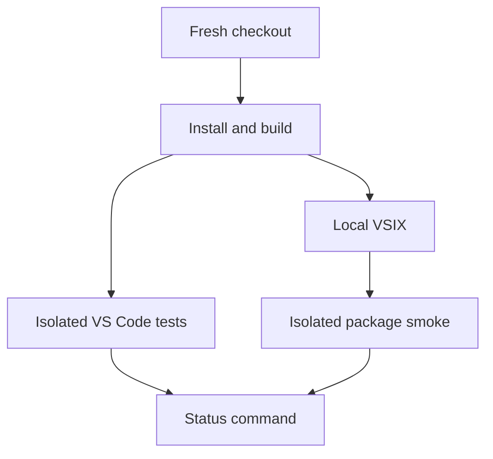

# Loadable extension foundation and contributor workflow

## Problem and outcome

Mure has product/design documents and a Tiki roadmap, but no executable extension,
package manifest, tests or contributor build loop. Establish one small, loadable desktop
extension that a contributor can build, test and package from a fresh checkout.

This is a foundation increment, not the first complete Mure release. It originates from
[architecture and contributor setup](../../roadmap/QCDKXS-extension-foundation.md).
The [broad workbench draft](../persistent-workbench/KFDQFD-spec.md) remains held;
its runtime capabilities are not inherited into this scope.

## Decisions and constraints

- One extension package at the repository root, using strict TypeScript, npm and a
  committed lockfile. Pin/document a supported development Node/npm toolchain. No npm
  workspace, monorepo, daemon, application framework or production runtime dependency is
  needed for this increment.
- Use the TypeScript compiler for checking and CommonJS output. A bundler adds no current
  value to this small dependency-free runtime; defer it until a real need appears.
- Use the official `@vscode/test-cli` / `@vscode/test-electron` integration-test tooling
  and `@vscode/vsce` for local packaging. Pin the test VS Code version, align the declared
  engine minimum and API types with that tested baseline, and choose emitted JS/Node API
  compatibility for the extension host, not merely the developer's installed Node.
- Keep activation/registration/disposal thin. Document the intended dependency direction:
  future pure checkout/policy logic must not import VS Code, filesystem or transport code;
  adapters perform effects and lifecycle composition connects them. Create modules only
  for behavior implemented now: no empty adapters, placeholder reconciler, generic event
  bus, service container or invented interfaces for later cards.
- Add one command, **Mure: Show Status**, with stable ID `mure.showStatus`. It activates the
  extension on demand and displays the installed extension version plus an explicit
  foundation/inactive message: Herdr connection and following are not implemented.
  Do not claim to detect a server or enable Mure. Register disposables with VS Code.
- The diagnostic command works with no folder open and in Restricted Mode because it
  reads only its own extension metadata. No project files, cwd/Git probes, socket access,
  telemetry, workspace mutation, file navigation or terminal/process control. It must
  not auto-run on startup. This does not authorize future trust-sensitive behavior.
- Keep the native `.code-workspace` as the future folder manifest. `workflow.yaml` remains
  Tiki configuration; neither is read or synchronized by this foundation.
- Provide documented npm commands for check, build, test and package, plus a native
  extension-development launch configuration. A fresh `npm ci` must suffice; scripts
  must not depend on globally installed TypeScript/vsce or the author's absolute paths.
- Add GitHub CI for dependency installation, checking, build, native extension tests on
  Linux with a virtual display, and VSIX packaging. No publish job, tokens, release
  creation or automatic installation into the user's normal VS Code profile.
- Include only runtime output and necessary public metadata/assets in the VSIX. Exclude
  tests, source maps/source, tooling, CI configuration, Tiki artifacts and personal/local
  state. Preserve MIT licensing, existing artwork and its SVG source. A PNG rendition
  or packaging-only README adjustment is allowed for vsce compatibility; no branding
  redesign or validation bypass.
- Keep the README short and honest about foundation-only behavior. Add concise contributor
  instructions, update agent verification commands, and distinguish actual structure from
  future architecture in DESIGN.md. Record tested platform/version evidence, not universal
  compatibility claims. Local macOS plus CI Linux evidence is sufficient for this slice.

## System view

## Acceptance

| Scenario | Expected observable result | Evidence |
| --- | --- | --- |
| Fresh checkout | Pinned tooling and `npm ci` produce checked, runnable extension output and a local VSIX using documented commands. | Clean-checkout install/check/build/test/package results; no global build tool reliance. |
| Native activation | Invoking `mure.showStatus` activates the extension and displays its own version with an honest inactive/foundation message. | Production-seam red/green integration check: inactive before command invocation, active afterward, without calling `extension.activate()` first; native UI smoke for visible copy. |
| Empty or untrusted workspace | Diagnostics remain available without trust prompts initiated by Mure, filesystem/server access or mutation. | Native empty-window and actually untrusted-fixture exercises with Workspace Trust enabled; source inspection of the bounded activation path. Do not disable trust to make the check pass. |
| Existing editor state | Explicitly invoking diagnostics does not open a document, change roots, retarget a terminal or restart the host. | Isolated multi-root smoke with an existing editor and terminal; before/after folder/editor/terminal/host identities. The user-invoked notification may take normal UI focus; this is not a background-follow test. |
| Repeat invocation and lifecycle | Repeated use works without duplicate registrations; extension lifecycle resources are disposed through native subscriptions. | Native integration checks and lifecycle inspection, without fabricating future resource abstractions. |
| Packaged artifact | VSIX installs and its command works in an isolated profile using only shipped runtime files; no dev dependencies or source checkout required at runtime. | Archive inventory and isolated packaged-install smoke without an extension-development path or another installed Mure copy that could mask missing package files. |
| CI and contributors | CI exercises the documented check/build/test/package path; a contributor can reproduce it and understand the source boundaries. | Workflow/native configuration checks and the same local commands; actual hosted run evidence when available. No claim that unrun CI passed. |

## Non-goals

- Herdr discovery, protocol client, sockets, event handling or checkout resolution.
- Home/binding setup, folder attachment/removal, Explorer following or cleanup.
- Runtime YAML configuration or workspace-file synchronization.
- Shipping the prototype, creating empty future modules, a custom UI or remote/web support.
- Marketplace/GitHub Release publication, an automatic updater or normal-profile install.
- Finalizing the next feature's scope, or accepting the broad workbench outcome as one PR.

## Resume / Progress

- Current: human-accepted foundation-only scope. Astra High SPEC assessment found no
  blockers; parent incorporated its three advisories before acceptance. Roadmap origin
  is promoted. No delivery tickets or scaffold exist yet.
- Next: verified Herdr handoff to one Sol High owner, who runs `ahy-to-tickets` then
  `ahy-orchestrate` in the same feature worktree/session.
- User authorized committing/pushing the planning baseline and starting that worktree.
  Implementation remains bounded to this spec; the broad workbench draft stays held.

## Sources and evidence

- Repository inspection: docs/assets only; no production extension, package manifest or
  tests to reuse. Local tools observed: Node 26.13.0, npm 12.2.0, VS Code 1.145.2 on arm64.
  These observations are not compatibility floors or proof of downloadable test builds.
- [VS Code extension testing](https://code.visualstudio.com/api/working-with-extensions/testing-extension)
  documents the native Electron test runner; tests can require a VS Code download.
- [Manifest reference](https://code.visualstudio.com/api/references/extension-manifest) and
  [Workspace Trust](https://code.visualstudio.com/api/extension-guides/workspace-trust)
  distinguish declared support from runtime guards. Diagnostics have no trust-sensitive
  effects; future features must revisit their trust boundary.
- The prior Explorer-only probe proves a later capability is viable, not that this
  unimplemented foundation has passed its acceptance checks.

## Comments

### 2026-11-13T03:55:34Z | control-plane-draft | attempt 1

- User authorized continuing with a foundation-only spec, not runtime synchronization or
  whole-extension delivery. Drafted one package/build/test/load outcome from the roadmap.
- Toolchain and source boundaries above are proposed for acceptance. No implementation,
  dependency installation, CI run, publication or delivery handoff performed.

### 2026-11-13T03:59:23Z | astra-spec-review-and-parent-repair | attempt 1

- Read-only Astra High SPEC assessment of the uncommitted foundation draft, design and
  roadmap context: ready for human review, no blockers; this is not human acceptance.
- Parent incorporated three advisories: permit unchanged-artwork packaging conversions;
  require real command-triggered activation, Restricted Mode and package-only smoke;
  clarify that later distribution reuses foundation build/test/package prerequisites.
- Local Tiki discovery, Markdown target and whitespace checks passed before review;
  final documentation checks rerun after repair. No implementation tests exist or ran.
- Tool compatibility, native-test execution and package smoke remain delivery evidence
  to collect. Repairs did not receive a second assessment. No handoff or promotion.

### 2026-11-13T04:04:35Z | human-acceptance | attempt 1

- Human explicitly approved this foundation-only spec and requested commit/push plus a
  new Herdr delivery worktree. This accepts the reviewed/repaired draft, not KFDQFD or
  any Herdr synchronization, following, attachment or cleanup feature.
- Promoted the architecture/contributor roadmap card. The destination Sol High parent will
  author delivery tickets with `ahy-to-tickets`, then continue with `ahy-orchestrate`.
- Planning parent retains control until the pinned operator verifies the Pi handoff;
  acceptance does not claim worktree creation, prompt delivery or implementation completion.
