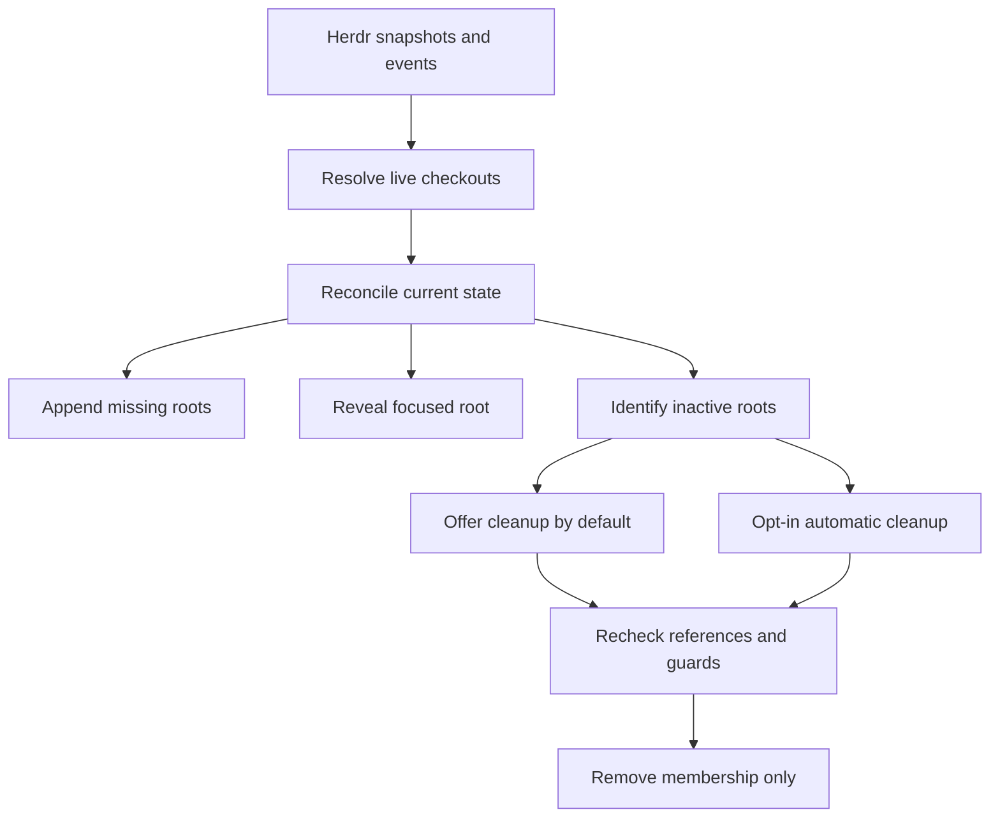

# Persistent Herdr-linked VS Code workbench

## Problem and outcome

The user works in Ghostty/Herdr beside VS Code. Reopening projects or moving the focused
project to the first workspace slot restarts extensions and interrupts the editor's
continuity. Keep one saved, multi-root workbench with a fixed personal home, attach live
Herdr checkouts, and follow the focused pane in Explorer without restarting that environment.

**Held outcome reference — not an accepted whole-extension delivery assignment.**
The user chose roadmap-led, incremental development rather than one-shot implementation.
The capabilities below preserve product intent, not a single release boundary. Capture
ideas in [the roadmap](../../roadmap/), then develop and accept bounded specs individually.
[Product direction](../../../PRODUCT.md), [terminology](../../../CONTEXT.md), and
[proposed interfaces](../../../DESIGN.md) provide context. Architecture and the first
release boundary still need decisions; no particular increment order is accepted yet.

## Decisions and constraints

### Workbench and control

- Use a thin VS Code extension connected directly to a selected local Herdr server.
  Server paths and the VS Code window must share filesystem identity. Do not translate
  remote paths or claim cross-platform verification from the macOS pilot.
- Setup is explicit for one saved workbench: choose a home directory and server, preview
  any workspace conversion, and obtain confirmation before changing its first root.
  Binding consent explicitly authorizes automatic addition of qualifying local Git
  checkouts reported by that selected server, subject to native Workspace Trust handling.
  Explain that attached roots become available to project-sensitive editor tooling.
  The native `.code-workspace` is the only folder manifest; no companion YAML or daemon.
- Home stays first. Changing it through settings is a deliberate reconfiguration with a
  restart warning; background reconciliation never repairs/reorders the first slot
  silently. Pause and explain if the configured home is missing or no longer first.
- Operate only inside the explicitly enabled workbench. At most one active controller
  may manage a saved workspace, bound to one selected server; additional controllers
  remain passive even if they request a different endpoint. Other VS Code windows and
  all Herdr topology remain untouched.
- Native settings, command palette and status affordances are sufficient: setup/change
  home, connection/follow state, refresh, pause/resume, cleanup, and restore excluded
  roots. Exact command names are implementation details. Pause suspends background
  membership writes and focus following, not just the visual indicator.
- Detect conflicting Navigator automatic following for this workbench and pause with
  actionable guidance. Do not globally disable another extension or silently change its
  settings. Mure must not require an integrated-terminal Herdr client.

### Membership and focus

- Derive membership from live Herdr workspaces and all live pane directories, not saved
  project definitions or zoxide history. Resolve a pane's foreground cwd when available,
  otherwise cwd, to its actual Git checkout root. Workspace checkout metadata can supply
  additional live references but must not override the focused pane's resolved checkout.
- Canonical local checkout path identifies a root. Subdirectories/symlink aliases dedupe;
  separate worktrees remain separate even when they share a remote or main repository.
  Use worktree checkout paths, never substitute the main repository's root. Non-Git pane
  directories are not auto-added; home and manually added directories remain allowed.
- Add an eligible missing checkout after home without removing or reordering existing
  roots. Existing manual roots satisfy membership but are never adopted as Mure-owned.
- On focus changes, select and reveal/expand the latest focused checkout root in Explorer.
  Visibility alone does not satisfy following. Do not open a
  file, switch the active editor or terminal, take keyboard focus, foreground VS Code,
  alter Herdr focus, or reload the workspace. Unsupported/missing targets leave the
  current editor context intact and show a non-disruptive status.
- Coalesce focus bursts, serialize workspace mutations, and discard stale plans before
  applying them. A changed cwd in the same pane must eventually be detected through
  bounded refresh/polling; do not assume focus events cover directory changes.
- Persist ownership and user exclusions per binding. If the user manually removes a
  managed root, suppress automatic re-add until they explicitly restore it. A manual
  re-add is user-owned; only an explicit Mure restore may record Mure ownership again.
  Never infer ownership from folder presence or Git identity alone; ambiguous ownership
  is protected as user-owned.

### Cleanup and failure behavior

- Default cleanup is offered, not automatic: keep inactive roots until the user invokes
  a multi-select cleanup command. Revalidate each selected root against current state
  before applying removal. No recurring interruption on each Herdr close is required.
- Provide an opt-in automatic-removal setting. In either mode only Mure-owned roots with
  no remaining live references are candidates. Never remove home or user-owned roots.
  Remove membership only: never delete files/worktrees or terminate sessions.
- Defer removal for dirty documents under the root, associated active debug sessions,
  or associated live integrated terminals. Where association of a live terminal or active
  debug session is unknown, conservatively defer cleanup rather than certify the root as
  safe. Explain deferrals.
  Arbitrary extension-private chats/sessions are not fully observable; disclose this
  limitation when automatic removal is enabled, without promising universal isolation.
- Disconnection, stale/incomplete snapshots, protocol failures and unresolved reference
  paths mean unknown state. Retain roots and do not remove them. Missing disk paths do
  not authorize recreation or deletion. Reconnect reconciles a fresh complete snapshot;
  never replay historical focus events or shell commands.
- Validate server-reported directories as local absolute filesystem paths before probing
  or loading them. Reject relative paths, malformed values and remote URI interpretation;
  never substitute a different endpoint or resolve against an arbitrary working directory.
- Respect Workspace Trust. Do not launch Git/process probes or mutate membership before
  the managed workbench is trusted, and never bypass native trust decisions for newly
  attached roots. Use argument-based process calls, not shell input assembled from server
  paths. Mure needs directory/checkout metadata, not note bodies or terminal transcripts;
  do not log secrets or private content.

## System view

The fixed home and existing root order are invariants across every background path.

## Acceptance

| Scenario | Expected observable result | Evidence |
| --- | --- | --- |
| First setup / home change | User controls the saved workbench/home; first-root restart warning precedes deliberate reconfiguration; unrelated windows unchanged. | Real VS Code setup exercise and workspace readback. |
| Existing manual roots / another window | No ownership adoption or unrelated-window writes; duplicate controller stays passive. | Restart/concurrent-controller integration checks and ownership readback. |
| Projects opened through existing Herdr pickers | The resulting live checkout appears once without hooking or changing those pickers. | Recorded server fixtures and live same-filesystem exercise. |
| Multiple panes, subdirectories and worktrees | One root per canonical checkout; distinct worktrees retained; focused pane can point outside its workspace's original repository. | Reconciler tests including symlink and absent-metadata cases. |
| Same-pane cwd change and rapid focus changes | Latest resolvable target wins; cwd changes are detected; no stale workspace write or focus replay. | Burst/cwd/reconnect scenarios at the source and editor boundaries. |
| Background focus following | Matching Explorer root is selected and revealed; home/order and active document/terminal remain unchanged; no host restart or keyboard/OS focus theft. Visibility alone fails. | Real selection and extension-host lifecycle evidence plus external-app keyboard-focus observation. |
| Default cleanup / last reference closes | Root remains until cleanup is chosen; only selected eligible owned roots are removed. | Real workspace and fresh-reference tests. |
| Automatic cleanup / protected work | No home/manual-root removal; dirty documents, known sessions and unresolved associations defer cleanup; no disk or process deletion. | Positive removal plus protected/unknown-state integration cases. |
| Manual removal / restart / re-add | Exclusions and ownership survive restart; no immediate re-add; manual re-add is protected. | Persistence and workspace-event tests. |
| Disconnect, invalid data or missing path | Existing roots retained, intelligible status, no fallback terminal input or arbitrary folder creation; recovery uses current state. | Failure/reconnect tests. |
| Paused, untrusted or conflicting follower | No background membership/focus mutations; user can resolve state and resume explicitly. | Trust/pause/conflict integration checks. |
| Malformed path / newly encountered untrusted checkout | Invalid, relative or remote-URI paths are not probed/loaded; no fallback endpoint; native trust decisions are respected without auto-approval. | Path-validation and native Workspace Trust integration checks. |
| Packaged extension with no Foam | Installable VSIX works through the same setup and follow path without optional notes tools. | Packaged VSIX smoke test; GitHub Releases distribution documented. |

Critical feasibility check: background Explorer selection and reveal must meet the
focus-preservation acceptance above. If native APIs cannot do so, stop and return with evidence for a product
decision; do not silently substitute a custom Explorer or weaken that guarantee.

Existing evidence: repeated first-root changes restarted hosts; fixed-root file navigation
preserved the host; shared Foam-home queries/dashboard were workable. On 2026-11-12, a
disposable native extension probe used `revealInExplorer` to select three roots in sequence.
DOM observations confirmed selection; root order and host PID were unchanged. VS Code
reported unfocused throughout, with no intervening focus event; OS samples showed Ghostty
frontmost but did not cover every call. The user confirmed the behavior worked well.
The probe had no active editor or terminal: preserving existing ones and third-party
extension compatibility remain untested. These probes are not a passing test of Mure,
which has no production implementation yet.

## Non-goals

- Reordering the first root on focus; reopening folders/windows as a following mechanism.
- Terminal/session control, Herdr topology changes, worktree creation/deletion, or agent dispatch.
- Remote filesystem mapping, event-history replay, an extra YAML inventory or background daemon.
- Foam installation/configuration, note migration, dashboard generation, Tiki mutations or
  fixes to third-party extensions' multi-root behavior.
- Marketplace publication, finalized branding, or a custom workbench UI.

## Resume / Progress

- Current: held in `needs-info` as an outcome reference. The user clarified that the
  extension must be planned through roadmap cards and bounded specs, not delivered from
  this entire draft in one pass. Prior Astra review and repairs remain historical evidence.
- Next: populate the roadmap, settle architecture and the first useful release, then
  draft a bounded spec for review and human acceptance.
- Documentation commit/push is authorized separately. It does not accept this broad scope
  for implementation or authorize a delivery handoff.

## Comments

### 2026-11-12T05:35:11Z | spec-review-and-repair | attempt 1

- Read-only Astra High SPEC assessment: nearly ready, with two blocking clarifications;
  reviewed the initial uncommitted spec, product/design/context and repository contracts.
- Parent repair: made server-driven addition consent and local absolute-path validation
  explicit; required actual Explorer selection as well as visibility; extended unknown
  cleanup-association protection to active debug sessions. Aligned product/design docs.
- Assessment accepted the native-selection/no-focus feasibility STOP as adequate. It did
  not reproduce the runtime experiments; repaired wording has not had a second assessment.
- Checks: root-scoped Tiki resolves this spec; bootstrap template/schema comparison, local
  Markdown links and whitespace checks passed. No implementation tests exist or were run.
- Human acceptance and delivery handoff remain pending.

### 2026-11-13T03:35:48Z | control-plane-planning-update | attempt 1

- User clarified that whole-extension, one-shot delivery is not intended and selected the
  roadmap-led process. Held this draft in `needs-info`; retained its outcome and safeguards
  as reference rather than dispatch authority. No delivery tickets or handoff created.
- Native Explorer probe on 2026-11-12 confirmed root selection, stable order/host, and an
  unfocused VS Code window; the user confirmed the behavior. OS sampling was partial;
  the empty test host did not exercise preservation of existing editors or terminals.
- User authorized committing and pushing the documentation baseline. This is not approval
  of an implementation stack, release boundary, installation, release or full-scope delivery.
